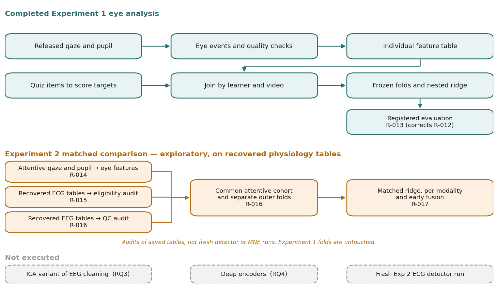
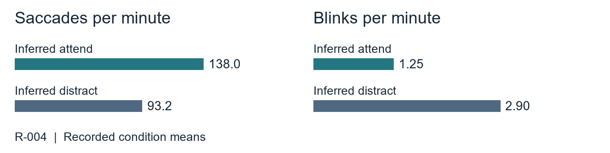
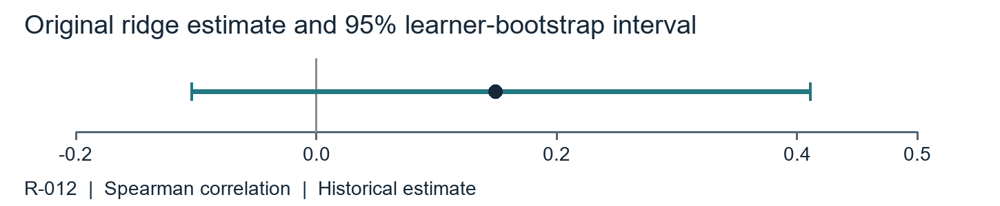

# MULTIMODAL MACHINE LEARNING (MML)

## FINAL PROJECT REPORT

**Project Title:** Predicting Learning from Educational Videos Using the Brain Body and Behavior Dataset

**Course:** DATA404 — Multimodal Machine Learning (MML)

**Team Members:**

1. Priyanka Bhatt — 2023UG000127
2. Tanmayee K M — 2023UG000134

**Faculty:** Dr. Minati Rath

**Institution:** Vidyashilp University

**Academic Year:** 2026–2027

**Submission Date:** 17 November 2026

**Draft dated 15 November 2026.** This draft incorporates the completed R-013 eye analysis. This draft also includes the exploratory Experiment 2 sensor comparison (R-017).

## 1. Abstract

We investigate whether measurements collected during educational videos predict quiz performance for unseen learners. Using the Brain, Body, and Behavior Dataset (BBBD), we reconstructed eye events, applied quality exclusions, and predicted within-video standardized memory quiz scores with learner-grouped ridge regression. The exploratory condition contrast showed lower saccade rates and higher blink rates during inferred distracted viewing (R-004). The post-result correction used eight eye features, 120 observations and 25 learners (R-013). It yielded Spearman ρ = +0.108, 95% learner-bootstrap CI [−0.126, +0.354], and raw permutation p = 0.032 (R-013). The estimate suggests a weak ranking association with substantial uncertainty. Across-modality Holm correction remains pending. In Experiment 2, the matched ridge comparison did not establish eye–EEG equivalence or a ranking gain from early fusion (R-017). A separate audit of saved Experiment 2 EEG tables found higher absolute power in the session labelled distracted, with posterior alpha the largest standardized effect but delta, theta and beta also shifted, so the difference is not confined to alpha and no alpha-specific component survives correction (R-018). Processing both Experiment 2 sessions from raw reproduced the distraction effects on saccade and fixation rates, but returned no blinks at all, so the ocular explanation for the EEG result could not be tested directly (R-019); its scalp distribution is not frontal-dominant (R-020), and reprocessing the raw EEG shows the effect survives EOG regression essentially unchanged, so it is not ocular (R-021). Deep-learning benefits remain an open question.

## 2. Introduction

### 2.1 Background and motivation

Educational videos provide a common stimulus while learners differ in attention, prior knowledge and subsequent performance. Previous studies associate neural or eye-movement synchrony with recall [2], [3]. These findings motivate physiological measurement, but they do not imply that every feature representation yields useful predictions for a new learner. In particular, similarity to a group watching the same video differs from a feature obtained from one learner's recording alone.

Our motivating question is whether eye and cardiac measurements could offer useful alternatives or complements to EEG. The project was designed as a multimodal comparison, with replication checks before predictive modelling. The completed empirical analysis currently concerns eye tracking. The distinction matters because availability of software for several modalities is not evidence that a multimodal model has been evaluated.

### 2.2 Problem statement and objectives

Given a learner's physiological recording during an educational video, predict the learner's standardized quiz score while excluding that learner from model training. We use quiz performance as an operational measure of information retained; without a matched pre-test and post-test, it is not a direct measure of learning gain.

The objectives are to reconstruct signals and events from released raw files, validate the processing against attention-related effects or reference annotations, evaluate individual features on unseen learners, and ultimately compare modalities and fusion on matched observations. Additional planned objectives examine peer-based synchrony, EEG cleaning variants and deep representations. The present report distinguishes these objectives from achieved results.

### 2.3 Scope and completion

| Component | Current evidence | Scope of the claim |
| --- | --- | --- |
| Eye event validation | Registered R-004 | Exploratory attention-condition contrast |
| EEG condition validation | Registered R-018 | Exploratory audit of saved Experiment 2 alpha tables; session difference in absolute power, not shown to be alpha-specific |
| Exp 2 eye condition validation | Registered R-019 | Saccade and fixation effects reproduced from raw with sidecar labels; blink channel empty, so the direct ocular check on R-018 could not be run |
| Exp 2 EEG topography | Registered R-020 | Low-frequency increase is distributed, not frontal-dominant |
| Exp 2 EEG ocular control | Registered R-021 | First from-raw EEG run; the condition effect survives EOG regression with d_z changing by at most 0.08 |
| RQ3 cleaning comparison | Registered R-022 | Modality ranking EEG > eye > ECG stable under both ICA and EOG regression; confirmatory version not executed |
| Deep-learning component | Registered R-023 | Eye-only attention decoding at 0.797 against a 0.764 hand-crafted baseline; the auxiliary task, not RQ4 |
| RQ4 Task C, eye only | Registered R-024 | Deep embeddings give no advantage for quiz prediction; Tasks A and B not attempted |
| Eye quiz prediction | R-013 complete under DV-02 | Post-result correction. Across-modality inference pending. |
| ECG and EEG processing | Batch code on physiology branch | Recovered physiology audited in R-015 and R-016 and used in exploratory R-017 |
| ISC and multimodal fusion | Shared components or planned integration | Early fusion evaluated in R-017. Individual-versus-ISC comparison pending. |
| Deep-learning track | Auxiliary decoder (R-023) and Task C (R-024) | Deep models trained and evaluated; neither beats hand-crafted features. RQ4's contrastive and fusion tasks not attempted |

The project's broad objectives are only partly achieved. A final scope decision, including the deep-learning requirement, remains for the team and faculty; this report does not treat an uncompleted objective as silently removed.

## 3. Literature Review

### 3.1 Physiological synchrony and educational outcomes

Cohen et al. [2] examined EEG responses to educational videos in intentional and incidental learning settings. They quantified neural engagement through inter-subject correlation (ISC) and related it to retained information and attentional condition. This provides a physiological motivation for the project. Our evaluation asks a complementary question: whether a fitted predictor using individual features generalizes to held-out learners.

Madsen et al. [3] studied eye-movement synchrony during instructional videos and its relationship to test performance across viewing contexts. Their work motivates eye tracking as a source of attention-related information. ISC compares a learner with other viewers of the same content, whereas our completed feature set uses only that learner's gaze and pupil recording. We do not directly compare published effect sizes with our cross-validated correlation because the representation, scoring and evaluation procedures differ.

Madsen and Parra [4] investigated synchrony across EEG, eye and cardiac measurements during attentive and distracted viewing. Their findings connect cognitive processing with shared fluctuations in several signals, while not all measured modalities show the same pattern. This motivates testing complementary information rather than assuming that adding sensors necessarily improves prediction.

### 3.2 Dataset, representations and evaluation

BBBD provides the shared data resource for investigating these questions, with synchronized neural, physiological and behavioural recordings and quiz information [1], [9]. The released files enable independent preprocessing, but their layout and metadata must be verified before analysis. We distinguish the authors' experimental findings from our own registered reanalysis.

Lawhern et al. [5] introduced EEGNet, using depthwise and separable convolutions for compact EEG classification. This architecture informs the project's EEG encoder design. Its published BCI evaluations do not establish effectiveness for educational quiz prediction, and our implementation has not yet produced a BBBD deep-learning result.

Varoquaux [6] demonstrates that prediction estimates can have substantial uncertainty in small samples and that variation across cross-validation folds is not a reliable substitute for uncertainty estimation. This motivates reporting learner-level resampling and repeated splits. Repeating folds stabilizes evaluation over assignments; it does not create additional independent learners.

### 3.3 Comparison of relevant work

| Study | Signals and representation | Main contribution | Relationship to this project |
| --- | --- | --- | --- |
| Cohen et al. [2] | EEG ISC during educational videos | Links neural engagement with recall and attention | Motivates EEG validation and prediction |
| Madsen et al. [3] | Gaze and pupil synchrony | Relates synchronized eye behaviour to test scores | Motivates individual-versus-peer feature comparison |
| Madsen and Parra [4] | Neural, eye and cardiac synchrony | Examines common modulation across signals | Motivates multimodal comparison without presuming fusion gains |
| Lawhern et al. [5] | Compact convolutional EEG representations | EEG-specific feature learning across BCI tasks | Architectural reference for the unexecuted DL track |
| Varoquaux [6] | Cross-validation uncertainty | Shows the importance of sample size and uncertainty | Motivates cautious interpretation and learner bootstrap |

This comparison identifies differences in questions and representations, not a numerical ranking of studies. The current project cannot establish improvement over these papers without a matched evaluation.

## 4. Research Gaps and Problem Identification

The project focuses on three practical questions left unresolved by our existing evidence. First, a learner-specific representation removes the need for a peer reference at inference time, but its predictive information may be weaker than synchrony. Our completed eye analysis tests the individual-feature side; the relative advantage of ISC remains unmeasured.

Second, comparing sensors requires the same participants, targets and splits. An eye model from Experiment 1 and an ECG model from Experiment 2 are not a paired test of modality quality. Such a comparison would confound modality with cohort and experimental context. Multimodal claims therefore require a cohort with aligned modalities and a documented common inclusion set.

Third, a pipeline may reproduce a condition effect without predicting individual quiz performance accurately. Event detection, attention-condition validation and prediction must be evaluated separately. We address this through staged registered runs, explicit quality checks and preservation of unsuccessful or superseded analyses. These are methodological contributions to this course project, rather than a claim that prior research lacks such practices.

## 5. Proposed Methodology

### 5.1 Data and outcomes

We analyse the public BBBD release identified by Zenodo record 19241964 [9]. It contains recordings organized by experiment, participant, session and task, with gaze/pupil and physiological modalities available across the collection [1]. We conducted a secondary analysis and collected no new participant data.

The completed validation uses Experiment 1: 27 learners and 263 gaze recordings, each paired with a pupil file (R-004). The target-building run identifies 31 learners with quiz records, of whom 27 overlap with gaze (R-006). We use memory questions, excluding domain questions from the outcome under D-27. The target is the proportion of scored memory items answered correctly for each learner and video. It is standardized within video before joining to the modelling sample (R-006).

The actual fields are `participant_id`, `stimulus_id`, `question_type`, `question_no`, `answer`, `correct_answer` and `is_correct`, as documented with R-006. Filename task identifiers such as `stim01` are normalized to the integer video keys used by the quiz table. Key overlap and uniqueness are checked rather than inferred from matching filenames.

### 5.2 Eye preprocessing and exclusions

The released gaze coordinates are treated as pixels despite the filename containing `visualangle`. We use a constant conversion of 33.64 pixels per degree (R-004; D-26), based on the documented apparatus and an inferred screen resolution. This approximation and the inferred condition mapping are limitations, not verified metadata facts. Angular velocity is computed from position rather than thresholding the supplied smoothed velocity channels.

The configured I-VT detector uses a 30°/s threshold. Blink candidates come from pupil dropout; the implementation distinguishes short blink intervals from longer loss of tracking and pads invalid intervals by 100 ms. Short gaps of at most 250 ms may be interpolated. These are processing settings, not estimated performance values. The validation and feature pipelines have related but distinct implementations; R-004 should not be interpreted as a validation of every downstream feature.

For prediction, the invalid fraction returned by the pupil-processing routine includes padding around invalid intervals. The preregistered exclusion is applied at greater than 50% invalid pupil samples. R-010 excludes 15 of 135 attend-session learner–video rows, leaving 120 observations and 25 learners; two learners lose all their videos. The frozen R-011 folds cover this retained sample. R-004 preceded this prediction exclusion implementation and includes its own broader validation sample.

### 5.3 Individual representations

| Feature in R-010/R-012 | Interpretation |
| --- | --- |
| `eye_invalid_frac` | Fraction of padded invalid pupil samples; a quality-related predictor |
| `saccade_rate_min` | Detected saccades per recording minute |
| `blink_rate_min` | Detected blinks per recording minute |
| `fixation_rate_min` | Detected fixations per recording minute |
| `fixation_dur_ms_mean` | Mean duration of detected fixations |
| `pupil_mean_raw` | Mean pupil signal after invalid samples are masked |
| `pupil_diff_sd_z` | Variability of successive differences in standardized pupil signal |
| `gaze_dispersion_deg` | Spatial dispersion of the gaze coordinates in degrees |

All eight predictors are derived from one learner's recording; none requires peer recordings. This does not guarantee that they measure cognition alone. For example, pupil level and invalid fraction can reflect measurement conditions as well as behaviour.

### 5.4 Physiology and fusion extensions

The implemented ECG components use NeuroKit2 [7] for signal cleaning and R-peak detection, RR plausibility filtering, and heart-rate/variability features. H0a specifies one-to-one matching to the authors' reference peaks within ±50 ms and F1 ≥ 0.95 per recording. R-015 registers a retrospective audit of saved ECG metrics. A prospective detector validation remains pending. The batch code also leaves the final ECG exclusion decision undetermined rather than substituting reference recall for the preregistered detectable-beat rule.

The EEG implementation uses MNE [8] for filtering, bad-channel interpolation, average referencing and EOG regression. The physiology branch aligns separately stored EEG and EOG using event boundaries, checks units and channel counts, and extracts regional spectral features after QC. These implementation details describe available code, not evidence of completed EEG experiments.

Planned classical fusion uses feature concatenation or combination of modality-specific predictions. Planned deep fusion combines modality embeddings through early, late or cross-attention heads. ISC references and CorrCA weights must use training learners only. R-017 evaluates feature concatenation. Late fusion and deep fusion remain planned.

### 5.5 Training and evaluation

The primary model family is standardized ridge regression, with random forest and a small MLP as exploratory secondary models. R-011 provides five learner-grouped outer folds repeated with ten saved seeds. A learner never crosses training and test partitions within a grouped scheme. A separate leave-one-video-out scheme deliberately allows the same learners in training and test and answers a different generalization question.

The intended analysis uses Spearman correlation for ranking, MAE for error magnitude, a baseline comparison, within-video target permutations and learner-resampled confidence intervals. The original R-012 implementation and the completed DV-02 correction (R-013) differ as shown below. The original output is preserved rather than silently replaced.

| Element | Original R-012 | Correction under D-31 / DV-02 |
| --- | --- | --- |
| Outer observations and folds | R-006/R-010 inputs; R-011 folds | Unchanged |
| Ridge tuning | Default RidgeCV inside outer training set | Three-fold GroupKFold; scaler fitted inside each inner training fold |
| Reported prediction | Average across ten repeats | Average across ten repeats |
| Permutation statistic | First repeat only | Same ten-repeat average as observed statistic |
| Baseline reporting | Conventional R² labelled as training-mean performance | Conventional R² and separately named training-mean skill |
| Multiplicity | Eye-only Holm family | Raw eye p; across-modality inference explicitly pending |

The correction uses the existing 30 logarithmically spaced ridge penalties from 10⁻³ to 10⁴, selects by mean inner-fold squared error, retains 1,000 permutations and 2,000 learner bootstrap resamples, and does not alter significance thresholds. It was designed after seeing R-012 and is therefore labelled a post-result correction. R-013 completed this analysis. D-31 remains Proposed.

## 6. System Architecture and Project Pipeline

Figure 1. The completed Experiment 1 eye route, the exploratory Experiment 2 matched comparison, and the components that were never executed. Every solid box carries the run ID that registered it. Dashed boxes were not executed and have no results of any kind. The Experiment 2 band operates on recovered physiology tables rather than fresh detector or MNE runs, which is why every run in it is labelled exploratory; the frozen Experiment 1 folds are not reused there.

The ingestion module locates files and reads sidecars. Signal modules perform event detection or physiological preprocessing. Target and feature tables are joined using normalized participant and video identifiers. Frozen folds then control model fitting and evaluation. Run logging records the code revision, configuration hash, seed and output directory, connecting every reported project estimate to a registered execution.

For future multimodal integration, signals must be aligned to a common recording interval and feature rows matched before comparison. A new experiment cannot be attached to Experiment 1's outer folds by assumption. Any additional fold construction or altered inclusion set requires documentation under the project's preregistration rules.

## 7. Implementation

### 7.1 Software organization and tools

The project uses Python with NumPy, pandas, SciPy and scikit-learn [10] for tabular processing and classical evaluation. MNE supports EEG processing [8], NeuroKit2 supports cardiac and respiration routines [7], and PyTorch supplies the unexecuted deep-learning components. Configuration is centralized in `config.yaml`. Core modules are in `src/bbbd/`; numbered notebooks provide the execution interface.

| Module or artifact | Responsibility |
| --- | --- |
| `io.py`, `config.py` | File discovery, metadata access and configuration |
| `eye.py`, `features.py` | Eye events and individual feature definitions |
| `ecg.py`, `eeg.py`, `resp.py` | Physiological processing components |
| `cv.py`, `stats.py`, `isc.py` | Splits, evaluation, resampling and fold-dependent references |
| `models_dl.py` | Encoders, contrastive objective and fusion heads |
| `runlog.py`, `docs/run_registry.csv` | Run identity and provenance |
| `reconcile_eye.py`, `85_statistics.ipynb` | Separately registered DV-02 correction and resumable Colab execution |

Some older notebooks still contain data-assembly and analysis logic. The corrected evaluation is centralized in a tested module; the existence of the library does not mean every historical notebook already follows that organization completely.

### 7.2 Execution and reproducibility

Colab is the working execution route for Member A. Local Windows scientific dependencies are blocked by the machine's security policy; the policy was not disabled. GitHub Actions provides the project test gate, including synthetic-data tests and notebook syntax checks. Raw physiological files remain outside Git, while small registered result tables and metadata are versioned.

The correction can run on a CPU using the existing registered tables, without downloading the raw dataset. Its Colab launcher backs up permutation checkpoints to Drive and refuses incompatible resumes. Package versions are recorded for the corrected run. Earlier dependency declarations use lower bounds, so the original run's exact environment must not be reconstructed from an old package list by assumption.

The repository's committed historical notebooks currently lack saved cell outputs. Registered CSV and JSON results provide evidence, but the final code submission also needs executed notebooks or equivalent saved execution output, as required by the course.

### 7.3 Division of work

Priyanka Bhatt carried out the experiments reported here. The original division assigned eye processing, targets and modelling to Priyanka and physiology to Tanmayee K M. Both members are responsible for understanding the pipeline and presenting the project.

## 8. Experimental Results and Evaluation

### 8.1 Registered evidence and experimental populations

Results below come from the project run registry and saved artifacts. R-004 is exploratory because it preceded the preregistration tag. R-012 was originally labelled confirmatory, but DV-02 now records implementation discrepancies; R-013 provides the separately registered corrected evaluation.

| Stage | Registered output | Population or artifact |
| --- | --- | --- |
| Eye condition validation | R-004 | 27 learners; 263 recordings |
| Target construction | R-006 | 31 quiz learners; 27 overlap with gaze |
| Prediction exclusions | R-010 | 135 candidate rows; 15 excluded; 120 retained |
| Shared prediction folds | R-011 | 25 learners; 120 rows; ten grouped repeats plus LOVO |
| Original prediction | R-012 | Eight individual eye features; target `quiz_z` |
| EEG condition validation | R-018 | Exp 2; 291 recordings; 30 learners, all paired |
| Exp 2 eye condition validation | R-019 | Exp 2; 302 recordings, 5 excluded; 31 learners, all paired |
| Exp 2 EEG topography | R-020 | Exp 2; 263 recovered recordings; 28 learners, all paired |
| Exp 2 EEG ocular control | R-021 | Exp 2 from raw; 264 of 291 recordings; 28 learners |
| RQ3 cleaning comparison | R-022 | R-016 cohort fixed; 125 rows; 26 learners; EEG columns swapped |
| Attention decoding | R-023 | Exp 2 both sessions; 297 recordings; 31 learners; 36,172 windows |
| RQ4 Task C | R-024 | R-016 cohort; 125 rows; 26 learners; single repeat, three seeds |

The validation and prediction samples are not interchangeable. In particular, the exploratory condition contrast must not be described as using the final prediction exclusion set.

### 8.2 Exploratory eye validation

The condition table reports the paired condition contrast from R-004. Values are means of learner-level summaries; the sign of the t statistic follows session 01 minus session 02. Session 01 is inferred to be attend and session 02 distract under D-29; that mapping is not directly stated in the released labels.

| Measure | Inferred attend | Inferred distract | Paired t | p | Run |
| --- | --- | --- | --- | --- | --- |
| Saccades per minute | 138.0 | 93.2 | 6.18 | 1.6 × 10⁻⁶ | R-004 |
| Blinks per minute | 1.25 | 2.90 | −3.04 | .0054 | R-004 |
| Fixations per minute | 131.8 | 84.1 | 7.02 | 1.9 × 10⁻⁷ | R-004 |
| Mean of recording median fixation durations, ms | 245 | 332 | −4.82 | 5.4 × 10⁻⁵ | R-004 |

Figure 2. R-004 recorded condition means, redrawn without recomputing statistics. Saccades and blinks use separate axes. No error bars are shown because this figure reproduces the saved means rather than introducing an unregistered uncertainty estimate. See the paired tests in the condition table.

The opposite directions of the saccade and blink changes are consistent with the intended condition contrast. Pupil-derived blink detection provides a check independent of the pixel-to-degree conversion. However, aggregate condition effects do not establish per-recording event agreement with the authors. That comparison was not completed in R-004.

### 8.3 Original eye prediction and implementation review

| Model | Spearman ρ | 95% learner-bootstrap CI | Conventional R² | MAE | Status |
| --- | --- | --- | --- | --- | --- |
| Ridge | +0.149 | [−0.104, +0.411] | −0.073 | 0.764 | R-012 original ridge estimate |
| Random forest | +0.231 | [+0.023, +0.415] | +0.005 | 0.733 | R-012 exploratory; unpermuted |
| MLP | +0.037 | [−0.252, +0.361] | −0.590 | 0.901 | R-012 exploratory; unpermuted |

All entries in the prediction table are from R-012, using predictions averaged across ten learner-grouped repeats. MAE is in within-video standardized quiz-score units. These estimates do not establish a statistically supported model ranking.

Figure 3. R-012 ridge estimate and saved 95% learner-bootstrap interval. The interval spans zero. The figure shows the historical estimate. Section 8.4 reports the corrected result.

R-012 records a permutation p-value of .026 alongside the ten-repeat estimate ρ = +0.149 and CI [−0.104, +0.411]. The code review shows that this p-value evaluates only the first repeat, whose saved correlation is +0.118, rather than the averaged statistic. Although permutation tests and bootstrap intervals generally answer different questions, that distinction alone cannot explain this particular comparison. The p-value must not be presented as a matched test of the headline averaged estimate.

The saved R² = −0.073 compares squared prediction error with deviations around the evaluated-target mean. It does not directly compare predictions with foldwise training-mean predictions. The one-member Holm calculation also leaves p unchanged; it does not complete correction across all planned modalities. For these reasons, this draft does not repeat the original unqualified H1a support claim.

Across the ten grouped repeats, ridge correlations range from +0.006 to +0.305 (R-012), showing sensitivity to the split assignment. Leave-one-video-out ridge gives ρ = +0.374 (R-012), but permits the same learners on both sides of the split. It therefore cannot be used as evidence of stronger unseen-learner prediction.

### 8.4 Corrected analysis and physiology results

R-013 refitted the same nested ridge pipeline for the observed targets and every within-video shuffle. It yielded Spearman ρ = +0.108, 95% learner-bootstrap CI [−0.126, +0.354], and raw permutation p = 0.032. Conventional R² = -0.031 uses the evaluated-target mean as its baseline. Skill against averaged outer-training-mean predictions was +0.027, a small reduction in squared error against that baseline. MAE was 0.759 standardized quiz-score units (R-013). Across-modality Holm correction remains pending, leaving the preregistered H1a claim unresolved.

Experiment 2 matched sensor evaluation (R-017). The shared attentive cohort used 125 learner–video rows from 26 learners across five videos (R-016). We fit ridge for each modality, eye plus ECG, and all three sensors on the same ten repeats. Scaling and penalty selection used three learner-grouped inner folds. The single-modality baseline selected the lowest inner mean squared error within each outer training set.

R-017 Spearman correlations were −0.216 (eye), −0.292 (ECG), +0.053 (EEG), −0.327 (eye plus ECG), −0.111 (all sensors), and −0.066 (selected single-modality procedure). EEG minus eye was +0.269 (90% paired learner-bootstrap CI [0.088, 0.462]). EEG minus eye plus ECG was +0.380 (90% CI [0.212, 0.550]). Neither interval fit inside ±0.10. All sensors minus the selected single-modality procedure was −0.044 (95% CI [−0.177, +0.073]), leaving the direction of a fusion effect uncertain.

The R-017 comparisons are exploratory because the physiology features came from recovered diagnostic executions. Bootstrap intervals resample learners with fixed held-out predictions. H2, H3 and H4 remain open.

### 8.5 Experiment 2 EEG condition check

Section 8.2 validates the eye pipeline against the published condition effects. The EEG half of that validation is reported here. An exploratory EEG alpha analysis of Experiment 2 was run on 15 October 2026 from the released raw BDF files, before the preregistration tag and outside this repository, so it carried no run ID. R-018 recomputes its paired statistics from the saved per-recording table under D-36 and DV-07. R-018 is an audit of that table: the raw recordings were not reprocessed here, and the audit does not certify how the October run executed. The recomputed values match the October summary to rounding. No quiz scores are involved, so this section bears on RQ0 only and changes nothing in Sections 8.3 and 8.4.

The sample is 291 recordings from 30 learners, all 30 contributing both sessions. Values are averaged within learner and session and compared with paired tests; the six alpha metrics are Holm-corrected together and the other frequency bands are descriptive. The session mapping is the assumed `ses-1 = attentive`, as in D-29 for Experiment 1.

| Metric | Family | Attentive | Distracted | Difference | d_z | t(29) | p | Holm p |
| --- | --- | --- | --- | --- | --- | --- | --- | --- |
| log alpha, post. | alpha | 0.083 | 0.157 | +0.074 | +0.80 | 4.37 | .0001 | .0009 |
| log alpha, all | alpha | 0.021 | 0.078 | +0.058 | +0.65 | 3.59 | .0012 | .0061 |
| rel. alpha, all | alpha | 0.952 | 0.974 | +0.021 | +0.11 | 0.58 | .56 | 1.00 |
| rel. alpha, post. | alpha | 1.026 | 1.025 | −0.001 | −0.00 | −0.02 | .98 | 1.00 |
| alpha vs flanks, all | alpha | −0.144 | −0.143 | +0.001 | +0.00 | 0.02 | .98 | 1.00 |
| alpha vs flanks, post. | alpha | −0.071 | −0.030 | +0.041 | +0.41 | 2.25 | .032 | .13 |
| log delta, post. | control | 0.944 | 1.073 | +0.129 | +0.71 | 3.91 | .0005 | — |
| log delta, all | control | 1.043 | 1.186 | +0.143 | +0.60 | 3.31 | .0025 | — |
| log theta, all | control | 0.343 | 0.413 | +0.070 | +0.43 | 2.36 | .025 | — |
| log beta, post. | control | −0.461 | −0.435 | +0.026 | +0.49 | 2.71 | .011 | — |

Table 1. R-018 recomputed condition contrasts, distracted minus attentive, paired by learner. "post." is the 17 occipito-parietal channels. Control-band rows are descriptive and are not part of the Holm family.

Absolute log power is higher in the session labelled distracted, which is the direction the reference paper reports for alpha. In standardized terms alpha is among the largest movers: posterior log alpha gives d_z = +0.80, the largest effect of any band in the table. **The effect is not, however, confined to alpha.** Posterior delta reaches d_z = +0.71, theta across all channels +0.43 and posterior beta +0.49, and delta has by far the largest raw shift, +0.143 against alpha's +0.058. The profile falls away with frequency — delta above theta and alpha, with beta and low gamma near zero — which is the shape of a low-frequency-weighted increase in power rather than a change confined to one rhythm.

Whether an alpha-specific component sits on top of that shift is unresolved. The metric designed for exactly that question, alpha measured against its 4–7 Hz and 13–20 Hz flanking bands, gives posterior d_z = +0.41 with raw p = .032 but Holm p = .13 within the six-metric family. That is suggestive at 30 learners and not established. The relative-alpha null is weaker evidence than it first appears: relative alpha divides alpha power by mean power over 1–40 Hz, a denominator that contains the rising delta, so it is biased toward zero in precisely the situation observed here. We report it for completeness rather than as a decisive negative.

Three limits bound the section further. No EOG regression or ICA was applied, so ocular and muscular artefacts are uncontrolled, and a low-frequency-weighted increase is also the signature of ocular contamination; Experiment 1 blink rates more than double in the distracted session (1.25 to 2.90 per minute, R-004), which makes this a live alternative explanation rather than a formality. Sections 8.6 to 8.8 report how we tested it. The robustness question RQ3 was written to answer is taken up in Section 8.9. The 30 learners here are not the 26-learner cohort behind R-016 and R-017, so these recordings and those predictions are not a matched sample, and the analysis predates the preregistration tag, so like R-004 it is exploratory and can never be confirmatory. One assumption is weaker than it first appears: R-018 recorded the attentive-distracted mapping as assumed, following D-29 for Experiment 1, but the Experiment 2 archive sidecars state the condition outright, and R-019 confirms 155 recordings labelled Attentive Condition and 147 labelled Distracted Condition. For Experiment 2 that mapping is read from the data, not inferred.

The honest summary is that our EEG preprocessing recovers a session difference in absolute low-frequency power that includes alpha but is not confined to it, that the evidence for an alpha-specific component does not survive correction, and and that an ocular explanation can be set aside, because the effect survives EOG regression on reprocessed raw recordings (Section 8.8). We do not claim to have reproduced the paper's alpha-specific effect.

### 8.6 Experiment 2 eye condition check, and the ocular question

R-019 processes both Experiment 2 sessions from the raw archive under D-37 and DV-08, so that attentive and distracted recordings can be paired within learner. R-014 covered the attentive session only, which was right for prediction and left no way to examine the ocular explanation for Section 8.5. The sample is 155 attentive and 147 distracted recordings from 31 learners, all 31 contributing both sessions, with five pupil-quality exclusions and condition taken from the sidecars. R-014 is unchanged.

| Metric | Attentive | Distracted | Difference | d_z | t(30) | p |
| --- | --- | --- | --- | --- | --- | --- |
| blink rate, per minute | 0.00 | 0.00 | 0.00 | — | — | — |
| saccade rate, per minute | 148.08 | 106.37 | −41.70 | −1.17 | −6.52 | 3.3e-07 |
| fixation rate, per minute | 128.93 | 84.08 | −44.85 | −1.77 | −9.85 | 6.5e-11 |

Table 2. R-019 paired condition contrasts over learner means. Blink rate is derived from pupil dropout and does not depend on the D-26 scale; the rate metrics do, but one constant scale applies to both sessions, so the within-learner contrast survives a wrong scale while the absolute values do not. Mean fixation duration is omitted: its distracted distribution reaches 184,773 ms with ten recordings above 2,000 ms, which is not interpretable.

**The test we wanted to run cannot be run.** Blink rate is identically zero in all 302 recordings, in both conditions. The reason is in the release rather than in our code. Reading every pupil file in the archive and counting its samples gives 158,178 non-finite values and one non-positive value out of 9,522,842, and all of them fall in six session-01 files: five are non-finite from end to end, which are the five R-014 exclusions, and the sixth holds a single bad sample, far short of the six consecutive samples a 50 ms blink needs at 128 Hz. Every one of the 147 distracted files is gap-free. The traces are continuous floats with almost as many distinct values as samples, so the pupil has been interpolated before release. Our blink rule keys on dropout (D-25), so there is nothing for it to find, exactly as the greater-than-50-per-cent gaze validity rule had nothing to find in Experiment 1 (D-30). This is not evidence that learners did not blink, and we do not read it that way. Defining a second, amplitude-based blink rule now, after seeing that this test failed, would be a post-hoc rule chosen to rescue a result; the question is recorded as open in D-38 and left for after submission. The ocular explanation for Section 8.5 therefore remains open on its main route.

One indirect argument does bear on it. Saccades are markedly fewer in the distracted session, by more than a standard deviation of the paired difference. Saccade-related artefact would therefore be lower in exactly the session where R-018 found more low-frequency power, which is the wrong direction to explain that result. This weakens a saccade-driven account; it says nothing about blinks, which are the larger low-frequency contributor and the ones we could not measure.

The section also extends RQ0. Our Experiment 2 eye pipeline reproduces the Experiment 1 distraction effects on saccade and fixation rates, in the same direction and at a comparable size (Experiment 1: 138.0 to 93.2 saccades per minute, R-004). It does so with condition labels read from the sidecars rather than inferred, which makes this the better-grounded of the two eye validations.

### 8.7 Scalp distribution of the Experiment 2 condition effect

With the blink route closed, one piece of evidence on the ocular question remains reachable without reprocessing raw EEG. Blink and eye-movement artefact projects maximally to frontal electrodes, so if the low-frequency increase in Section 8.5 is ocular it should be frontal-dominant. R-020 tests that under D-39 and DV-09 in the recovered regional band tables, which hold relative band power for frontal, central, parietal and occipital groupings across 139 attentive and 124 distracted recordings from 28 learners with both sessions. The primary statistic, the correction and the limits below were fixed before the run.

| Delta, distracted − attentive | d_z | p | Holm p |
| --- | --- | --- | --- |
| occipital | +1.19 | 1.0e-06 | 4.2e-06 |
| frontal | +1.08 | 4.2e-06 | 1.3e-05 |
| parietal | +1.01 | 1.3e-05 | 2.5e-05 |
| central | +0.70 | 9.4e-04 | 9.4e-04 |
| **frontal − occipital (primary)** | **−0.19** | **.33** | — |

Table 3. R-020 regional delta contrasts over learner means, Holm-corrected across the four regions. The primary row is the within-learner frontal-minus-occipital gradient: −0.0069, 95% learner-bootstrap CI [−0.0206, +0.0061], with 42.9 per cent of learners positive.

**The effect is not frontal-dominant.** The gradient is indistinguishable from zero and its point estimate is slightly posterior. Delta rises in all four regions and survives correction in all four, most strongly at occipital sites. That is not the topography of ocular contamination, and it is therefore evidence against an ocular explanation of Section 8.5.

Three limits bound how far that goes, all stated in D-39 before the run. On its own it does not clear the EEG, since it is a distribution argument rather than a correction; Section 8.8 supplies the correction. (These recovered tables in fact already carried EOG regression, which Section 8.8 establishes and which was not known when this section was written.) Relative band powers within a region sum to about 0.97, so the delta rise mechanically depresses theta, alpha and beta, and the falls we observe in those bands are not independent evidence; only delta was treated as primary for that reason. And these recovered tables come from a different pipeline than the analysis behind R-018, regional relative power rather than whole-scalp absolute log power, so the agreement in direction is reassuring rather than a replication.

Taken with Section 8.6, the indirect position on the ocular question was this. We could not test it through blinks, because the Experiment 2 pupil release carries none. Two indirect lines pointed away from it: saccades are fewer in the session with more low-frequency power, and the increase has no frontal gradient. Section 8.8 settles it directly.

### 8.8 Does the effect survive ocular correction?

R-021 reprocesses the raw Experiment 2 EEG and applies EOG regression, the approach the preregistered V1 pipeline specifies and the one the dataset authors use (D-12). It is the project's first from-raw EEG run; every earlier EEG result in this report audits saved tables. Each recording is filtered once and then preprocessed twice from that same copy, once with its EOG channels attached and once without, so the only difference between the two outputs is the regression. Of 291 raw recordings, 264 were processed and 27 excluded because the archive holds no matching EOG physio file; 28 learners contribute. The primary statistic and the correction were fixed in D-40 before the run.

| Delta, distracted − attentive | uncorrected d_z | **corrected d_z** | Holm p, corrected |
| --- | --- | --- | --- |
| occipital | +1.24 | **+1.26** | 1.4e-06 |
| frontal | +1.14 | **+1.06** | 1.7e-05 |
| parietal | +0.99 | **+1.03** | 1.8e-05 |
| central | +0.63 | **+0.59** | 4.1e-03 |

Table 4. R-021 regional delta contrasts with and without EOG regression, Holm-corrected across the four regions. The corrected frontal-minus-occipital gradient is −0.0078, 95% learner-bootstrap CI [−0.0214, +0.0049].

**The effect survives.** All four regions remain significant after correction and after Holm, and the effect sizes barely move. The largest change is frontal and amounts to d_z −0.08; parietal and occipital shift slightly the other way. A small frontal reduction with nothing elsewhere is what a little frontal ocular contamination sitting on top of a real neural effect looks like. It is not what an ocular effect looks like, which would have collapsed once the EOG-explained variance was removed. The corrected gradient remains non-frontal, agreeing with Section 8.7.

This run also corrects something stated earlier in this report. Matching R-021 against the recovered tables, 191 of 263 recordings agree to within 1e-6 in the **corrected** variant and none at all in the uncorrected variant, with median absolute differences of 0.0000 and 0.0034 respectively. The recovered EEG features were therefore produced with EOG regression already applied, so R-016, R-017 and R-020 all rest on ocular-corrected data. Section 8.7's caution that no ocular correction had been applied anywhere was wrong on that point; it was right only of R-018's separate 15 October analysis.

Two limits remain. EOG regression removes what the EOG channels explain and not ocular activity they miss, and ICA was deliberately not used because its component-selection threshold would have been chosen after seeing this result. And this is not itself RQ3, which asks about the modality ranking rather than the condition contrast; Section 8.9 takes that up.

### 8.9 RQ3: is the modality ranking stable under a different EEG cleaning?

RQ3 asks whether the modality ranking survives cleaning EEG with ICA instead of EOG regression. R-022 answers it on the Experiment 2 cohort, which is the only place in this project where a modality ranking exists. The preregistered confirmatory version would compare rankings on the Experiment 1 track, whose physiology was never processed and whose raw recordings are not available to us; that version remains not executed.

The comparison holds the R-016 cohort and its frozen folds fixed — 125 rows, 26 learners, the same eye features, ECG features and targets — and swaps only the 24 EEG columns between two cleanings of the same raw recordings. Each recording is filtered, bad-channel corrected and re-referenced once, then branches into EOG regression or ICA, so the cleaning method is the only difference. The D-35 matched ridge is rerun unchanged for each. All 125 recordings processed without failure.

| Held-out Spearman rho | EOG regression | ICA |
| --- | --- | --- |
| EEG | +0.080 | +0.123 |
| eye | -0.216 | -0.216 |
| ECG | -0.292 | -0.292 |
| eye + ECG | -0.327 | -0.327 |
| all sensors | -0.049 | -0.098 |
| training-selected single | +0.025 | +0.051 |

Table 5. R-022 modality scores under the two cleanings. The eye, ECG and eye+ECG rows are identical to four decimals, which is the check that the comparison changed nothing but the EEG features.

**The ranking is stable: EEG above eye above ECG under both cleanings.** The EEG minus eye contrast is +0.296, 90% CI [+0.115, +0.495] under EOG regression and +0.339 [+0.145, +0.522] under ICA; EEG minus eye+ECG is +0.407 [+0.238, +0.580] and +0.451 [+0.264, +0.609]. Every interval excludes zero. The fusion conclusion also holds and hardens: early fusion over all sensors never beats the training-selected single modality, at -0.074, 95% CI [-0.226, +0.059] under EOG regression and -0.149 [-0.291, -0.007] under ICA, where the interval excludes zero.

Three qualifications matter. **FastICA failed to converge on 19 of the 125 recordings**, so the ICA column rests partly on unconverged decompositions and should be read as indicative rather than definitive. The from-raw EOG-regression variant agrees with R-017 in ranking and in the direction of every contrast but not in magnitude - R-017 reported EEG +0.053, all sensors -0.111 and selected single -0.066 against +0.080, -0.049 and +0.025 here - because R-017 used the recovered feature tables while this run recomputes from raw; it is a reproduction in direction, not in value. And stability of a ranking among three weak predictors is a modest claim: it says the ordering survives a processing choice, not that any modality predicts well. EEG's own correlation is +0.08 to +0.12.

### 8.10 A deep-learning component: eye-only attention decoding

The project plan lists an auxiliary task alongside the main research questions: decoding attentive from distracted viewing for held-out learners. R-023 fits it as the project's deep-learning component. **It is not RQ4.** RQ4 asks whether deep encoders give better features for quiz prediction under fusion; no quiz score enters this run at all, so it bears on RQ1, RQ2 and RQ4 not at all. Whether it satisfies the course's deep-learning requirement is a decision for the team and the faculty, not something this result settles.

Everything was fixed in D-42 before any fitting, and most of it was fixed long before. Windows are 4 seconds at 50 per cent overlap, decided in D-21 on 6 November. Training follows the methods plan: AdamW at learning rate 1e-3, weight decay 1e-2, batch 256, three seeds, the encoder refit in every outer fold. The five D-32 pupil-quality exclusions are applied, leaving 297 recordings from 31 learners and 36,172 windows. Folds are grouped by learner with both sessions of a learner always together, and the early-stopping learners come from inside the training fold, so no learner is ever seen during training and testing. Inputs are gaze x, gaze y and pupil, each standardized within recording so the model cannot key on a learner's absolute offsets. The model is a small three-block 1D convolutional network with global pooling.

| Recording-level balanced accuracy | |
| --- | --- |
| CNN, three seeds averaged | **0.797** |
| CNN per seed | 0.787, 0.794, 0.773 |
| Hand-crafted baseline, same folds | **0.764** |
| Difference | +0.034 |

Table 6. R-023 decoding scores. The baseline is logistic regression on the eight eye features, fixed as mandatory in D-42 before fitting rather than chosen afterwards.

The decoder works: about 0.80 balanced accuracy for learners it has never seen. **It does not meaningfully beat the hand-crafted features.** The margin of 0.034 is only slightly larger than the 0.021 spread across three seeds, and no interval was computed for it, so we do not claim the network is better. Both approaches separate the conditions well, and the deep model buys little over eight numbers per recording.

Two things keep this modest. The task is easy by construction — R-019 puts the saccade-rate condition effect at d_z = −1.17 — so high accuracy shows the pipeline is sound rather than that the architecture is good. And deciding the condition a learner was in is a different and simpler problem than predicting what they learned, which is what the rest of this report is about and where every model remains weak.

### 8.11 RQ4 Task C: do learned eye features beat hand-crafted ones?

Section 8.10 showed a deep model matching hand-crafted features on the easy auxiliary task. R-024 asks the question RQ4 was actually written to ask: do deep encoder embeddings make better features for **quiz prediction**? It answers that for the eye modality alone.

**Tasks A and B were not attempted**, so RQ4 is still not executed as specified. D-43 records the reasoning rather than leaving it as an omission: contrastive EEG-eye alignment and three-modality fusion encoders, fitted on 125 rows from 26 learners, would produce a number with no interpretive value and a real risk of representation leakage in a pipeline assembled in one sitting.

The design keeps the comparison honest in one specific way. For each outer fold the eye encoder is pretrained from scratch on the attend-versus-distract objective using **training-fold learners only**, then frozen before its embeddings are used. An encoder pretrained once on everybody would have shaped its representation around the test learners' signals, even without ever seeing their quiz scores. Embeddings are mean-pooled per recording and fed to ridge on the frozen R-016 rows and folds; the hand-crafted eight-feature ridge is rerun on the same single repeat so the two are paired.

| Held-out Spearman rho, same 125 rows and folds | |
| --- | --- |
| deep embeddings, 64-d, three seeds averaged | **-0.077** |
| \quad per seed | -0.102, +0.009, -0.048 |
| hand-crafted, eight eye features | **-0.050** |
| paired difference, 95% CI | **-0.026 [-0.206, +0.158]** |

Table 7. R-024 Task C comparison. Both arms use identical rows, folds, target and repeat.

**Learned features give no advantage.** The deep arm is slightly worse, the difference is indistinguishable from zero, and both correlations are negative, so neither ordering beats chance on this cohort. On RQ4's own question, the answer at this sample size is no.

Three qualifications bound that. The run uses **one repeat rather than the preregistered ten**, which makes the levels unstable - the same hand-crafted features give -0.050 here against -0.216 in R-017's ten-repeat average, and the deep per-seed values span -0.102 to +0.009. Only the paired contrast within this run should be read, and neither number should be set against R-017's. Ridge on 64 dimensions over roughly 100 training rows is badly conditioned, and scikit-learn flagged ill-conditioning on three of the fifteen fits, so the deep arm is handicapped by dimensionality as much as by representation quality. And the encoder was pretrained for condition decoding, so this tests whether that particular representation transfers to quiz prediction, not whether any deep representation could.

## 9. Discussion

### 9.1 Interpretation and contributions

The strongest completed evidence is the exploratory eye condition contrast. It demonstrates that the implemented event pipeline can recover systematic behavioural differences in the released recordings. Predictive performance is more modest: the corrected ridge estimate is small and its learner-bootstrap interval includes zero (R-013). A condition effect should therefore not be equated with reliable individual score prediction.

The project contributes an inspectable chain from file-level assumptions to exclusions, feature tables, frozen folds and registered predictions. The implementation review adds a concrete lesson: a preregistered plan and a passing software test suite do not by themselves establish that an analysis implements the plan. The observed statistic, null procedure and baseline definition must also agree.

### 9.2 Limitations and alternative explanations

The prediction sample comprises only 25 learners (R-011/R-012), so its 120 rows are not independent participants. Resampling learners respects that clustering, but the bootstrap operates on existing out-of-fold predictions rather than retraining the entire model for each resample. Its interval should not be described as capturing every source of model-training uncertainty.

Quality and calibration remain important. Screen resolution and condition assignment are inferred; a constant pixel-to-degree conversion approximates the viewing geometry. The released gaze appears already interpolated, while pupil supplies the dropout information used for prediction exclusions. Missingness can influence both selection and the `eye_invalid_frac` predictor, providing a non-cognitive explanation for part of any association.

Quiz outcomes also constrain interpretation. Video 5 has 38.7% of quiz learners scoring at least 90% (R-006), limiting variability near the top of the scale. Scores are standardized within video on the target table before prediction-sample filtering. This is a cohort-relative task, not a demonstrated deployment procedure for a new video whose score distribution is unknown. Memory-item scores measure recall performance and cannot isolate learning gain from prior knowledge or other learner differences.

The original models use a limited hand-crafted representation. The random forest's larger point estimate is exploratory and unpermuted; choosing it as the winner after inspection would require a separate justified analysis. Neither the initial prediction output nor the planned correction establishes causality, suitability for student assessment, or generalization beyond this dataset.

### 9.3 Development challenges

Misleading filenames, smoothed derivative channels, inconsistent join-key formats and the distinction between gaze validity and pupil dropout required explicit inspection. These issues could produce plausible but incorrect outputs without raising a software exception. Environmental constraints also separated local editing, Colab execution and CI testing. Preserving failed runs and logging decisions made those problems visible rather than hiding them in a final notebook.

## 10. Conclusion and Future Work

We implemented and evaluated the eye-tracking portion of a broader multimodal learning-prediction project. Registered exploratory validation shows a clear condition contrast in eye events. The corrected unseen-learner ridge analysis yields a small, uncertain association (R-013). The matched Experiment 2 comparison did not establish equivalence or a fusion benefit (R-017). The work supports a reproducible processing and evaluation contribution, not a claim that eye tracking replaces EEG or that multimodal fusion improves learning prediction.

A fresh registered ECG detector validation remains a follow-up. R-015 documents the recovered-table audit. Subsequent work should obtain matched eye and physiological features within the same experiment, compare individual and training-fold ISC representations, and evaluate fusion on identical observations. EEG cleaning sensitivity and the deep-learning track require actual experiments with encoders retrained inside outer folds. Larger and independent learner cohorts would be needed to assess stability and practical usefulness. Objectives without results remain incomplete rather than being interpreted as negative findings.

## 11. References

[1] J. Madsen, N. Kuppa, and L. C. Parra, “The Brain, Body, and Behavior Dataset (BBBD): Multimodal Recordings during Educational Videos,” Scientific Data, vol. 13, article 920, 2026. https://doi.org/10.1038/s41597-026-07215-1

[2] S. S. Cohen et al., “Neural engagement with online educational videos predicts learning performance for individual students,” Neurobiology of Learning and Memory, vol. 155, pp. 60–64, 2018. https://doi.org/10.1016/j.nlm.2018.06.011

[3] J. Madsen, S. U. Júlio, P. J. Gucik, R. Steinberg, and L. C. Parra, “Synchronized eye movements predict test scores in online video education,” Proceedings of the National Academy of Sciences, vol. 118, no. 5, e2016980118, 2021. https://doi.org/10.1073/pnas.2016980118

[4] J. Madsen and L. C. Parra, “Cognitive processing of a common stimulus synchronizes brains, hearts, and eyes,” PNAS Nexus, vol. 1, no. 1, pgac020, 2022. https://doi.org/10.1093/pnasnexus/pgac020

[5] V. J. Lawhern et al., “EEGNet: A compact convolutional neural network for EEG-based brain–computer interfaces,” Journal of Neural Engineering, vol. 15, no. 5, 056013, 2018. https://doi.org/10.1088/1741-2552/aace8c

[6] G. Varoquaux, “Cross-validation failure: Small sample sizes lead to large error bars,” NeuroImage, vol. 180, pp. 68–77, 2018. https://doi.org/10.1016/j.neuroimage.2017.06.061

[7] D. Makowski et al., “NeuroKit2: A Python toolbox for neurophysiological signal processing,” Behavior Research Methods, vol. 53, pp. 1689–1696, 2021. https://doi.org/10.3758/s13428-020-01516-y

[8] A. Gramfort et al., “MEG and EEG data analysis with MNE-Python,” Frontiers in Neuroscience, vol. 7, article 267, 2013. https://doi.org/10.3389/fnins.2013.00267

[9] J. Madsen, N. Kuppa, and L. Parra, “The Brain, Body, and Behavior Dataset (BBBD): Multimodal Recordings during Educational Videos,” Zenodo, dataset record 19241964. Accessed 13 November 2026. https://doi.org/10.5281/zenodo.19241964

[10] F. Pedregosa et al., “Scikit-learn: Machine Learning in Python,” Journal of Machine Learning Research, vol. 12, pp. 2825–2830, 2011. https://www.jmlr.org/papers/v12/pedregosa11a.html

## 12. Appendix

### 12.1 Evidence map

| Evidence | Repository artifact |
| --- | --- |
| R-004 validation and event table | `results/R-004_eye_rq0_exp1/` |
| R-006 quiz target table | `results/R-006_targets_exp1/` |
| R-010 features and exclusions | `results/R-010_eye_features_exp1/` |
| R-011 archived splits | `results/R-011_folds_exp1/folds.json` |
| Canonical frozen splits | `results/folds.json` |
| R-012 metrics and predictions | `results/R-012_classical_eye_exp1/` |
| Post-result correction disclosure | `docs/deviations.md`, DV-02; `docs/decision_log.md`, D-31 |
| R-018 EEG condition tests and audited input | `results/R-018_exp2_eeg_alpha_audit/` |
| R-019 paired Exp 2 eye condition rates | `results/R-019_exp2_eye_condition/` |
| R-020 regional EEG condition contrasts | `results/R-020_exp2_eeg_topography/` |
| R-021 from-raw EEG, corrected and uncorrected | `results/R-021_exp2_eeg_ocular_rerun/` |
| R-022 EEG features by cleaning variant | `results/R-022_exp2_rq3_cleaning/` |
| R-023 decoding scores and predictions | `results/R-023_exp2_attention_cnn/` |
| R-024 Task C predictions, both arms | `results/R-024_exp2_rq4_taskc/` |
| R-013 execution record | `results/R-013_eye_reconciliation/provenance/console.log` |

### 12.2 Example recorded output

The R-012 saved ridge summary contains `spearman = 0.14925857830698283`, `ci_low = -0.10400707744998657`, `ci_high = 0.4107350892141163`, `r2 = -0.07341205029723996`, and `mae = 0.764331342309887`. These are saved outputs, not a newly executed analysis. The permutation mismatch and incomplete multiplicity assessment are described in Section 8.3.

### 12.3 Execution and presentation evidence

For the correction, download the current `85_statistics.ipynb` as a raw GitHub file and upload it into Colab rather than relying on a cached GitHub notebook view. Run its setup tests, authorize the new Drive backup folder, and retain the completed output bundle and executed notebook. Do not change frozen folds or thresholds in response to a result. A checkpoint marked in progress is not a final result.

The presentation can demonstrate the saved result table, the source feature definitions and the frozen-fold checks without rerunning the entire permutation procedure live. Any demonstration should clearly distinguish a displayed saved result from a fresh execution. Before submission, the team must package the registered R-013 artifacts and incorporate any newly registered physiology evidence, and save the code outputs required by the course.
